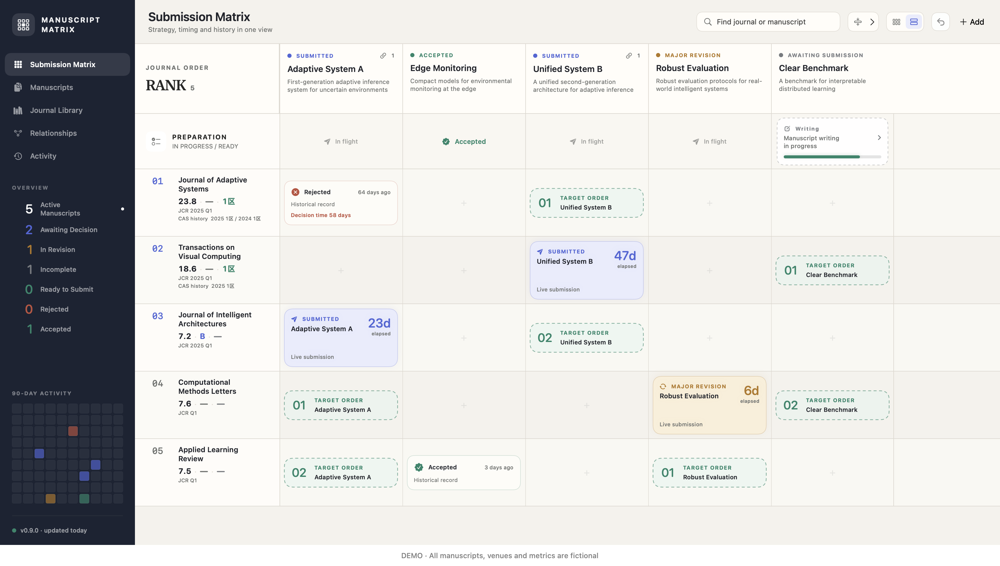

<p align="center">
  
</p>

# Manuscript Matrix

A native macOS board for planning submissions and following manuscripts through review.

[简体中文](README.zh-CN.md) · [Download](https://github.com/DongkunXu/ManuscriptMatrix/releases/latest) · [MCP guide](Docs/agent/AGENT_INTERFACE.md) · [MIT license](LICENSE)

Journals and conferences form ranked rows; manuscripts form columns. Each intersection shows a current submission, an ordered future target, or a historical outcome. Plans stay separate from actual submission events.



*All manuscripts, venue names, metrics and dates in the screenshot are fictional examples. A new installation starts with an empty board.*

## Features

- A submission matrix with fixed headers, two display densities, search and filters.
- Independent target ordering for each manuscript and an editable overall venue ranking.
- Submission, revision, resubmission, rejection, acceptance and withdrawal histories with elapsed-day indicators.
- Five preparation stages, from initial registration through ready to submit.
- Venue metadata, multiple classification systems and years, and journal-name history.
- Explicit manuscript relationships, an activity timeline, and an activity heatmap.
- Validated JSON backup/import, audited event corrections and session undo.
- English and Simplified Chinese interfaces, with system, light and dark appearance.
- A bundled CLI and local MCP server using the same validation as the app.

This app tracks submission strategy and history. It does not host manuscript files or supply journal metrics automatically.

## Install

Requires **macOS 15 or later**. The release ZIP contains a universal app for Apple silicon and Intel Macs.

1. Download `Manuscript-Matrix-<version>-universal.zip` from [Releases](https://github.com/DongkunXu/ManuscriptMatrix/releases).
2. Extract it and move **Manuscript Matrix.app** to Applications.
3. Open the app and add your own venues and manuscripts.

Published release builds are signed with Developer ID and notarized by Apple. No account or subscription is required. Run `shasum -a 256` on the ZIP and compare it with the accompanying `.sha256` file to verify the download.

## Your data

The app stores its board on your Mac at:

```text
~/Library/Application Support/ManuscriptMatrix/board-v1.json
```

It does not upload the board or include analytics, advertising, or cloud synchronization. Interface preferences use macOS UserDefaults. The JSON file is not encrypted by the app; protect it like other private documents. Use the app's export action for backups. Import replaces the current board after validation and can be undone during that app session.

The repository and release bundles contain no personal board or historical user imports. Demo mode uses fictional in-memory data and discards changes on exit:

```bash
open -na '/Applications/Manuscript Matrix.app' --args --demo
```

Updating or replacing the app bundle does not replace the separate board file. See [privacy and data handling](Docs/PRIVACY.md).

## Connect an AI client with MCP

The app includes the server; Python, Node.js, and Xcode are not required to use it. Example configuration for clients that accept `mcpServers`:

```json
{
  "mcpServers": {
    "manuscript-matrix": {
      "command": "/Applications/Manuscript Matrix.app/Contents/Helpers/manuscript-matrix-agent",
      "args": ["--read-only", "mcp"]
    }
  }
}
```

This configuration reads your personal board. Remove `--read-only` when you want the client to update it. For a safe first try, use `"args": ["--demo", "mcp"]`. Responses can include the full board: connect only a client you trust with that information. The server uses stdio and opens no network port; the AI client may have its own network behavior.

See [the MCP and CLI guide](Docs/agent/AGENT_INTERFACE.md) for data-file selection, tool payloads and examples.

## Build from source

Requires Xcode 26 or later, command-line tools, and [XcodeGen](https://github.com/yonaskolb/XcodeGen). The Swift package has no third-party package dependencies. Python 3 is used by release checks.

```bash
git clone https://github.com/DongkunXu/ManuscriptMatrix.git
cd ManuscriptMatrix
make test
make build
make run
```

`make run` and the generated Xcode scheme use the isolated demo board. Run `make release-build` for an unsigned universal Release app and MCP helper. See [release engineering](Docs/RELEASING.md) for signing, notarization, screenshots and cleanup.

## Project map

| Location | Purpose |
| --- | --- |
| `Apps/ManuscriptMatrixApp` | macOS entry point, settings, localization and icon |
| `Packages/ManuscriptKit` | Domain, commands, persistence, UI and MCP |
| `Contracts` | Machine-readable command schema |
| `Docs` | Architecture, data model, privacy, MCP and releases |
| `scripts` | Repeatable build and verification commands |

See [architecture](Docs/ARCHITECTURE.md), [data model](Docs/DATA_MODEL.md), and [contributing](CONTRIBUTING.md). Report reproducible problems through [GitHub Issues](https://github.com/DongkunXu/ManuscriptMatrix/issues); redact private titles, manuscript IDs, board exports and local paths first.

## License

[MIT](LICENSE). Commercial use, modification and redistribution are permitted; retain the copyright and permission notice in copies or substantial portions. The software is provided without warranty. Your manuscript records remain your data and are not licensed by this repository.
