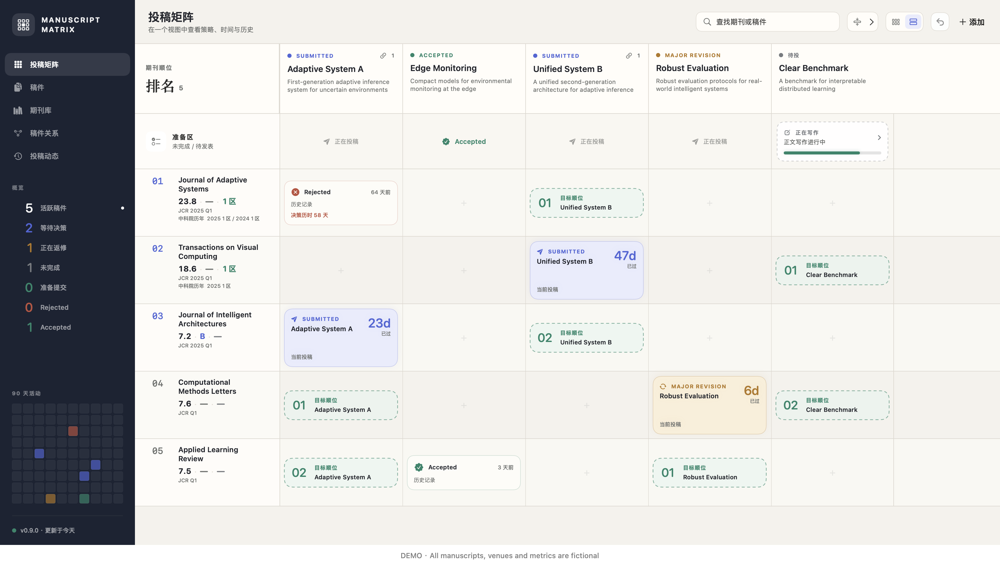

<p align="center">
  
</p>

# Manuscript Matrix

原生 macOS 投稿管理工具，用矩阵规划投稿目标、追踪审稿状态和保留投稿历史。

[English](README.md) · [下载](https://github.com/DongkunXu/ManuscriptMatrix/releases/latest) · [MCP 使用说明（英文）](Docs/agent/AGENT_INTERFACE.md) · [MIT 许可证](LICENSE)

期刊与会议是按顺位排列的行，稿件是列。每个交叉单元格展示当前投稿、后续目标或历史结果。调整目标不会自动产生投稿记录。



*截图中的稿件、期刊名称、指标和日期均为虚构示例。首次安装后，应用从空白面板开始。*

## 功能

- 投稿矩阵、固定表头、两种显示密度、搜索和状态筛选。
- 每篇稿件独立的投稿目标顺序，以及可调整的全局期刊顺位。
- 投稿、修回、重投、拒稿、录用和撤稿历史，以及经过天数提示。
- 从登记到待投稿的五阶段稿件准备状态。
- 期刊指标、多套分区体系及年份、期刊更名历史。
- 显式记录稿件关系、活动时间线与热图。
- 经过校验的 JSON 备份和导入、保留审计记录的历史纠正、会话内撤销。
- 简体中文和英文界面，系统、浅色和深色外观。
- 内置 CLI 和本地 MCP 服务，与应用共用数据校验和写入规则。

应用管理投稿策略和历史，不托管论文文件，也不自动提供期刊指标。

## 安装

需要 **macOS 15 或更新版本**。Release ZIP 内的通用应用同时支持 Apple 芯片与 Intel Mac。

1. 在 [Releases](https://github.com/DongkunXu/ManuscriptMatrix/releases) 下载 `Manuscript-Matrix-<版本>-universal.zip`。
2. 解压，将 **Manuscript Matrix.app** 移至“应用程序”。
3. 打开应用，添加自己的期刊和稿件。

正式发布版本经过 Developer ID 签名和 Apple 公证。不需要注册账号或订阅。可运行 `shasum -a 256`，与随附的 `.sha256` 文件核对下载完整性。

## 数据与隐私

面板保存在本机：

```text
~/Library/Application Support/ManuscriptMatrix/board-v1.json
```

应用不上传面板，不包含分析追踪、广告或云同步。界面偏好使用 macOS UserDefaults 保存。应用不会自行加密 JSON 文件，请按个人文档的标准保护它。使用应用的导出功能备份；导入会在校验后替换当前面板，可在该次应用会话中撤销。

源码仓库与安装包不包含个人数据库或历史用户导入。演示模式仅使用内存中的虚构数据，退出即丢弃修改：

```bash
open -na '/Applications/Manuscript Matrix.app' --args --demo
```

更新或替换应用本身不会替换独立保存的面板文件。详见[隐私与数据说明（英文）](Docs/PRIVACY.md)。

## MCP 接入

应用已内置 MCP 服务，使用时不需要安装 Python、Node.js 或 Xcode。支持 `mcpServers` 的客户端可参考：

```json
{
  "mcpServers": {
    "manuscript-matrix": {
      "command": "/Applications/Manuscript Matrix.app/Contents/Helpers/manuscript-matrix-agent",
      "args": ["--read-only", "mcp"]
    }
  }
}
```

该配置可以读取个人面板；希望客户端更新数据时，再移除 `--read-only`。初次试用可改为 `"args": ["--demo", "mcp"]`，使用虚构演示数据。

MCP 返回的信息可能包含完整面板，请只连接你信任的客户端。本地服务通过标准输入输出通信，不开放网络端口；AI 客户端自身可能会联网。完整配置、指定数据文件、工具与命令示例见 [MCP 与 CLI 指南（英文）](Docs/agent/AGENT_INTERFACE.md)。

## 从源码构建

需要 Xcode 26 或更新版本、命令行工具和 [XcodeGen](https://github.com/yonaskolb/XcodeGen)。Swift 包没有第三方包依赖；发布检查使用 Python 3。

```bash
git clone https://github.com/DongkunXu/ManuscriptMatrix.git
cd ManuscriptMatrix
make test
make build
make run
```

`make run` 和生成的 Xcode Scheme 默认使用隔离的演示面板。`make release-build` 会构建未正式签名的通用 Release 应用和 MCP 工具。签名、公证、截图和清理流程见[发布指南（英文）](Docs/RELEASING.md)。

## 参与与许可

架构、数据模型、开发与发布文档及代码注释使用英文。提交问题前，请去除真实稿件标题、稿件编号、数据库导出和本机路径。详见[贡献指南（英文）](CONTRIBUTING.md)与 [GitHub Issues](https://github.com/DongkunXu/ManuscriptMatrix/issues)。

采用 [MIT 许可证](LICENSE)：允许商业使用、修改和再分发；复制或分发软件的重要部分时，必须保留版权及许可声明。软件按原样提供，不附带担保。你的稿件记录仍属于你，不受本仓库许可证支配。
